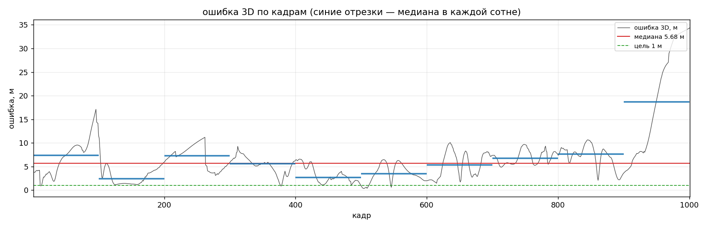

# 3D-трекинг фуры по пяти камерам — решение на боксах YOLO

Один прогон по видео даёт 3D-траекторию точки объекта (пивота) в абсолютной
системе координат сцены. Всё считается **онлайн**: значение для кадра `t`
зависит только от кадров `t` и более ранних.

## Результат

| метрика | значение |
|---|---|
| медиана ошибки | **5.68 м** |
| MAE | 6.83 м |
| RMSE (это MSE жюри) | **9.20 м** |
| p90 | 10.26 м |
| max | 34.39 м |
| покрытие | 999 / 1000 кадров GT (старт с кадра 1) |

По сотням кадров: 100–200 → 2.47 м, 400–500 → 2.73, 500–600 → 3.46,
700–800 → 6.72, 900–1000 → 18.66 (объект уходит из всех дальних камер).



## Как устроено

```
                оценка 3D на прошлом кадре (Калман)
                             │
               проекция + ковариация  →  оранжевое окно поиска
                             │
             YOLO по кропу (масштаб под размер объекта)
                             │
        ┌────────────────────┴────────────────────┐
   боксов >= 2                               бокс один
   триангуляция лучей                    фьюжн двух приоров:
   (веса из геометрии камер)        глубина из высоты бокса
        │                            + луч через низ бокса ∩ дорога
        └────────────────────┬────────────────────┘
                      причинный Калман (CV, CTRV-курс)
                             │
                  сдвиг пивота: +10 м по курсу, +4 м вверх
                             │
                       X, Y, Z (пивот)
```

### 1. Окно поиска вместо полного кадра

Фура занимает 20–300 px: на 300 м YOLO по кадру 1920 её не видит (5 попаданий
из 41), а в кропе 100×45 px с апскейлом — 29 из 41. Окно строится из текущей
оценки: проекция эллипсоида неопределённости (из ковариации фильтра) плюс
эллипсоид «кузов + тень» (радиус 10 м, высота 4 м, 16 точек), раздутый на
12 % + 5 px. Размер окна задаёт масштаб кропа: `s = clip(360 / ширина_объекта, 1, 6)`.

### 2. Измерение

- **Две и больше камер** — пересечение лучей через низ бокса, веса из
  геометрии: поперёк луча точность пиксельная (`2d/f + 70` см), вдоль луча —
  по размеру силуэта (`4d/size + 70` см). Ковариация — обратная матрица
  точности, поэтому фильтр сам решает, чему верить.
- **Одна камера** — луч без второй точки. Глубина берётся двумя способами и
  сливается по 1/σ²:
  - из высоты бокса: `d = f·H_eff / h`, где `H_eff` — «эффективная высота»,
    своя на каждую камеру, оценивается на многокамерных кадрах
    (sample-and-hold: 731/987/456/1103/831 см);
  - из земли: луч через низ бокса пересекается с профилем дороги
    (прямая `z = a + b·s`, оценивается по пройденному пути).
- **Ни одной камеры** — фильтр едет по инерции (`coast`), окно растёт.

### 3. Курс и сдвиг пивота

GT-точка — это пивот ассета (передний низ кабины), а не центр кузова:
сдвиг ~10 м по курсу и ~4 м вверх. Курс ведёт отдельный фильтр
`[угол, угловая скорость]`, измерение — смещение центра Калмана за 10 кадров.

### Что не сработало и почему

- Полный кадр 1920 без окна — детекций почти нет.
- NCC/CSRT-трекер вместо YOLO на пропусках — 11.8 м против 4.5 (шаблон
  бокового вида не ловит вид сзади).
- Курс по силуэту модели (IoU проекции) — 180°-неоднозначность, 20 м.
- Держать в Калмане пивот, а не кузов — обратная связь «курс → сдвиг →
  позиция → курс», разлёт до 129 м.
- yolo26l **не узнаёт фуру сзади** (conf 0.02 при виде «в корму») — это
  детектор, а не геометрия; отсюда провал 200–300 и хвост 900–1000.

## Файлы

| файл | что делает |
|---|---|
| `yolo3d.py` | весь пайплайн: окна, детекции, измерения, Калман, рендер видео |
| `validate.py` | собирает видео по сохранённому прогону, не запуская YOLO |
| `tested.md` | журнал экспериментов: что проверяли, что вышло, какие грабли |
| `core/` | база из ветки `dev`: камеры, сцена, геометрия, модель объекта |
| `config/roi.json` | ручной бокс на первом кадре CAM1 — единственная ручная подсказка |
| `out/yolo-like/` | результат: `track.csv`, `views.csv`, `debug.csv`, `metrics.json`, `validation.mp4` |

## Как запустить

Нужен python с `ultralytics`, `opencv-python`, `numpy`, `tqdm`; веса
`yolo26l.pt` и каталог `data/` (5 mp4 + 6 csv) лежат рядом со скриптами.

```powershell
# полный прогон (~3 минуты на RTX 2060, с видео)
python yolo3d.py --lo 1 --hi 1001 --out out/yolo-like

# только видео по уже посчитанному прогону (YOLO не нужен)
python validate.py --run out/yolo-like

# метрики и csv без видео
python yolo3d.py --lo 1 --hi 1001 --no-video --out out/yolo-like
```

Полезные ключи: `--conf` (порог детекции, 0.05), `--offset-fwd/--offset-up`
(сдвиг пивота, 10/4 м), `--heading-mode ctrv|chord`, `--accel` (шум процесса),
`--roi` (файл с ручным боксом), `--debug-crop N` (сохранить кропы окна).

Прогон надо начинать с кадра 1: там затравка берётся из `config/roi.json`
(один ручной бокс на первой камере). Старт с середины не инициализирован —
фильтру нечего взять за начало.

`yolo3d.py` пишет в каталог прогона:

- `track.csv` — ответ: `Frame;Loc_X;Loc_Y;Loc_Z` в сантиметрах (пивот);
- `views.csv` — окно поиска и детекция на каждый кадр и камеру (для `validate.py`);
- `debug.csv` — режим измерения, число камер, курс, ошибка;
- `metrics.json` — сводка и медианы по сотням кадров.

## Что дальше даст больше всего

1. **Маски вместо боксов** и подгонка модели по силуэтам — это убирает
   зависимость от ракурса (у нас высота бокса «плывёт» в 1.5 раза).
2. **Начало координат модели в пивоте** — тогда сдвиг +10/+4 перестаёт быть
   эмпирической константой.
3. **Детектор, знающий вид сзади** — сейчас 200–300 и 900–1000 теряются
   именно из-за него.
